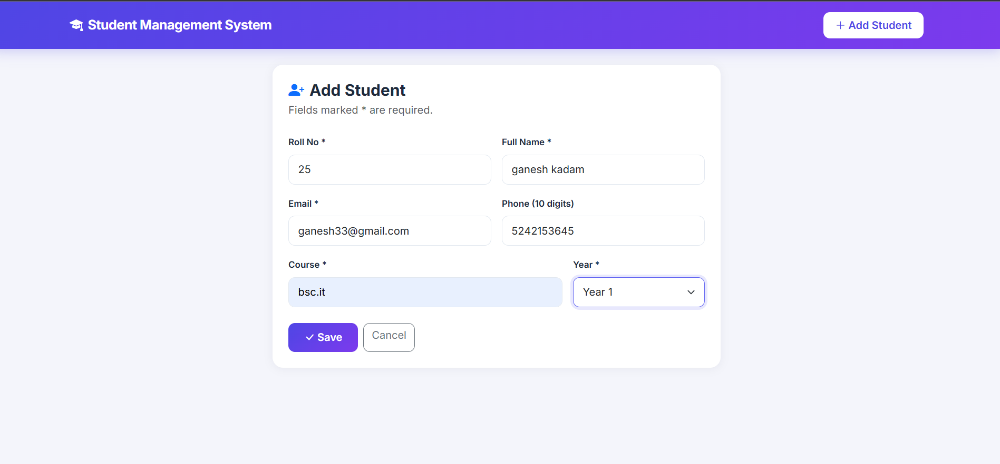
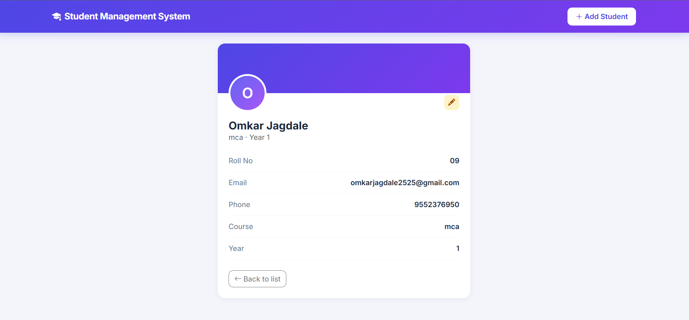

# 🎓 Student Management System

A CRUD web application to manage student records, built for the **Auspify Technologies Software Development Internship (Task 1)**.

## Features
- Add, view, update and delete student records
- Student detail page and dashboard stat cards
- Search by name, roll number, course or email
- Server-side validation (email format, 10-digit phone, unique roll no / email)
- Responsive UI with delete confirmation
- Automated tests with pytest

## Tech Stack
Python · Flask · SQLite · Jinja2 · Bootstrap 5

## Screenshots

### Home Page


### Search


### Add Student



### Edit Student


### Student Details



## Run Locally
```bash
git clone https://github.com/omkarjagdale2525-ui/student-management-system.git
cd student-management-system
python -m venv venv
venv\Scripts\activate
pip install -r requirements.txt
python app.py
```
Open http://127.0.0.1:5000

## Run Tests
```bash
pytest -v
```

## Project Structure
```
├── app.py          # routes + validation
├── database.py     # all SQL / data access
├── static/css/     # custom styling
├── templates/      # base, list, form, detail pages
├── tests/          # pytest suite
├── screenshots/    # README images
└── requirements.txt
```

## Author
Omkar Jagdale | #Auspify #AuspifyTechnologies #AuspifyInternship #AuspifyProjects